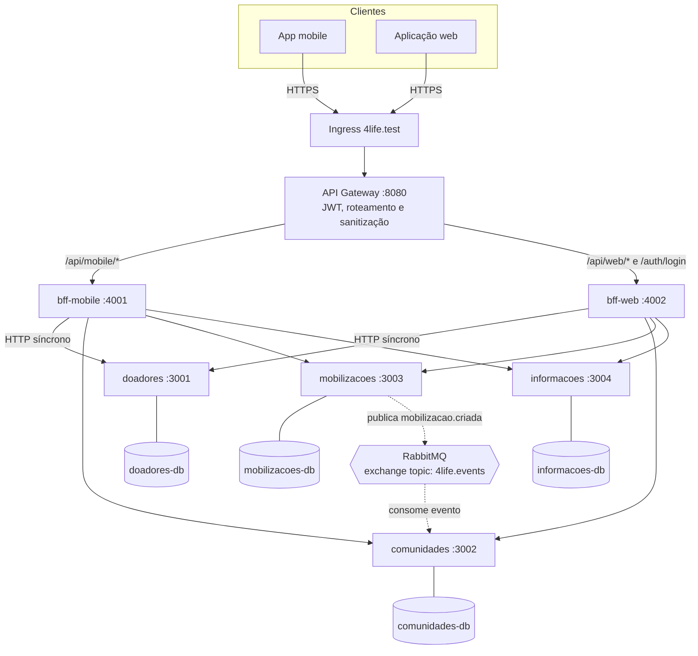
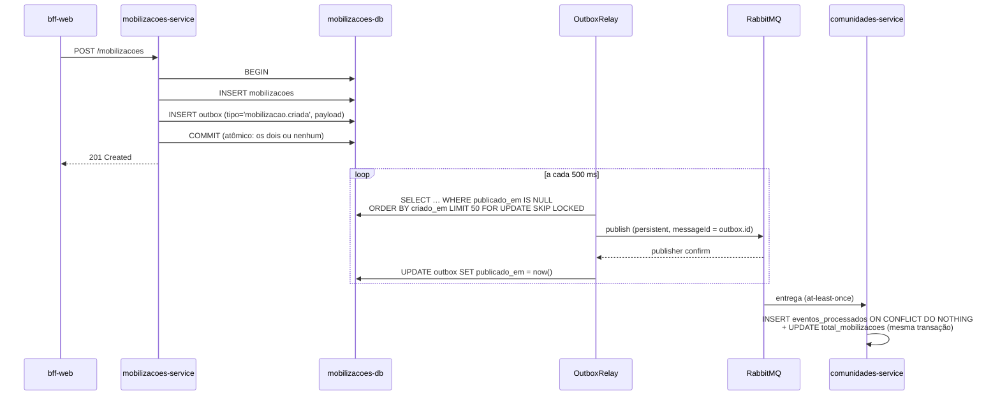
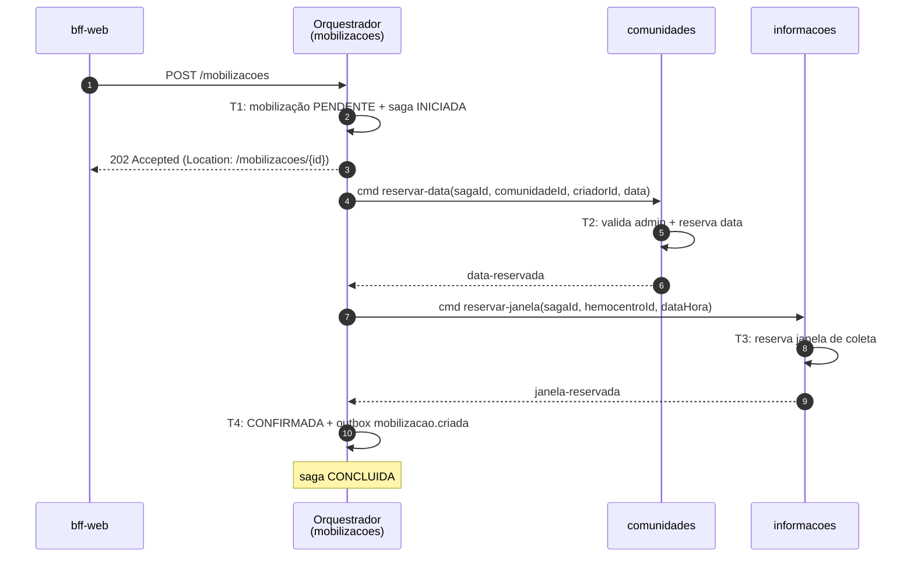
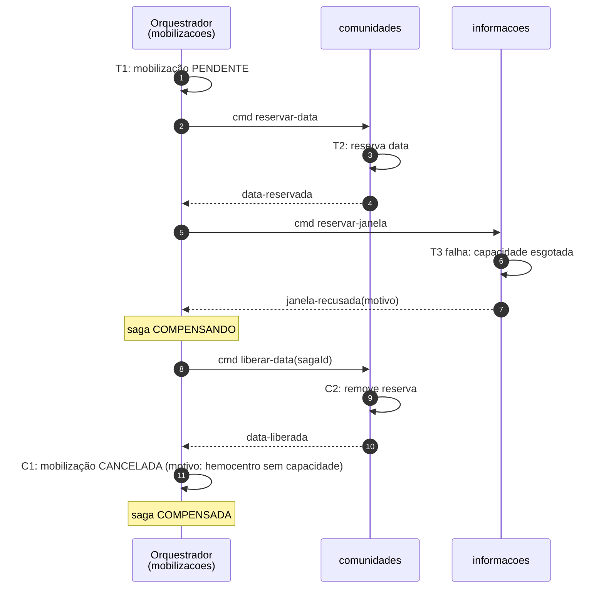
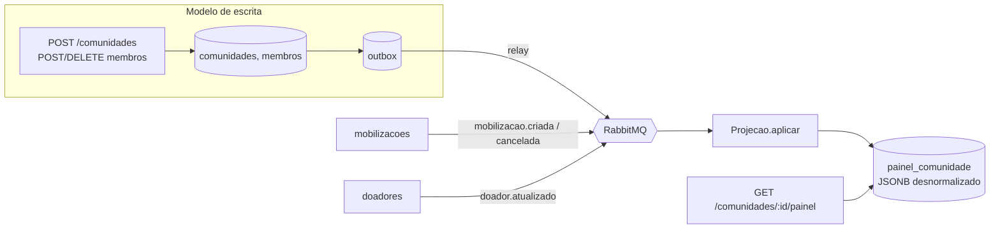

# 4Life — Arquitetura de Microsserviços

---

## Do problema à arquitetura

- O 4Life conecta **hemocentros, comunidades e doadores** por meio de **mobilizações** de doação de sangue.
- Na Parte 2 o monolito conceitual da Parte 1 virou um sistema distribuído:
  - **4 serviços de domínio**, cada um com o próprio banco;
  - **1 API Gateway** e **2 BFFs** (mobile e web);
  - **RabbitMQ** para os eventos entre domínios.
- Tudo containerizado (Docker Compose) e orquestrado (Kubernetes/kind).

---

## 1. Decomposição em microsserviços

| Serviço | Responsabilidade | Dados próprios |
|---|---|---|
| **doadores-service** `:3001` | Cadastro, perfil e verificação de credenciais do doador | `doadores` |
| **comunidades-service** `:3002` | Comunidades, membros, papéis (admin/membro), contador de mobilizações | `comunidades`, `membros`, `eventos_processados` |
| **mobilizacoes-service** `:3003` | Mobilizações (eventos de doação), vagas e interesses | `mobilizacoes`, `interesses` |
| **informacoes-service** `:3004` | Conteúdo educativo, FAQ, dicas e hemocentros (base do futuro chatbot) | `conteudos`, `faq`, `hemocentros` |

**Por que este corte (e não outro)?**

- **Um serviço por subdomínio de negócio, com ritmos de mudança diferentes.** O conteúdo educativo
  muda por curadoria editorial; as mobilizações mudam a cada campanha; o perfil do doador quase não muda.
- **Mobilização ≠ Comunidade.** A comunidade é o *grupo social* (quem organiza e quem participa); a mobilização
  é o *evento* (data, vagas, interessados). Juntá-los criaria um serviço que muda por dois motivos.
  Separados, o pico de carga (todo mundo vendo/se inscrevendo em mobilizações) escala **só** o `mobilizacoes-service`.
- **Interesse fica junto da mobilização**, e não em um serviço "participação", porque o controle de vagas
  (`SELECT ... FOR UPDATE`) precisa de **consistência forte** com a própria mobilização. Separá-los obrigaria
  a uma transação distribuída no caminho mais quente do sistema.
- **Informações é isolado** porque é público, somente-leitura na maior parte do tempo e vai alimentar o
  assistente LLM; ele não deve competir por recursos com o fluxo transacional.
- **Alternativa descartada:** um serviço "Hemocentros" separado. Hoje hemocentro é um dado orientativo
  (endereço, horários), sem regra própria. Ele fica em `informacoes` até ganhar comportamento.

---

## 1.1 Diagrama de componentes e de comunicação




- **Síncrono (HTTP/JSON):** gateway → BFF → serviços. Usado em consultas e comandos do usuário.
- **Assíncrono (RabbitMQ):** reações entre domínios, ex.: `mobilizacao.criada` incrementa o contador da comunidade.
- **Isolamento de rede:** o gateway só alcança os BFFs, os BFFs só alcançam os serviços, e cada serviço só alcança o
  próprio banco e o broker (redes `data-*` no Compose; `NetworkPolicy` + *default-deny* no Kubernetes).

---

## 2.0 API REST — contratos

Contratos **OpenAPI 3.0** de todos os componentes em [`docs/api/`](../api/):

| Arquivo | Endpoints principais |
|---|---|
| `doadores-service.yaml` | `POST /doadores` · `GET/PATCH /doadores/{id}` · `POST /auth/verificar` |
| `comunidades-service.yaml` | `GET/POST /comunidades` · `GET /comunidades/{id}` · `GET/POST /comunidades/{id}/membros` · `DELETE /comunidades/{id}/membros/{doadorId}` |
| `mobilizacoes-service.yaml` | `GET/POST /mobilizacoes` · `GET /mobilizacoes/{id}` · `POST /mobilizacoes/{id}/interesses` · `DELETE /mobilizacoes/{id}/interesses/{doadorId}` |
| `informacoes-service.yaml` | `GET /conteudos[/{slug}]` · `GET /dicas/aleatoria` · `GET /faq` · `GET /hemocentros[/{id}]` |
| `gateway.yaml`, `bff-mobile.yaml`, `bff-web.yaml` | Superfície pública por cliente |

Todos os serviços expõem `GET /health` (liveness) e `GET /ready` (readiness: banco respondendo e migrations
aplicadas). No `mobilizacoes-service`, que publica eventos, o `/ready` exige também a **conexão com o broker**.

---

## 2.1 Recursos, verbos e códigos de status

**Recursos são substantivos e as relações aparecem como sub-recursos:**
`/mobilizacoes/{id}/interesses/{doadorId}`, e não `/registrarInteresse`.

| Verbo | Uso | Exemplo |
|---|---|---|
| `GET` | leitura segura e idempotente, com filtros por query | `GET /mobilizacoes?cidade=Lavras&futuras=true` |
| `POST` | criação de recurso (subordinado ou não) | `POST /mobilizacoes/{id}/interesses` |
| `PATCH` | atualização parcial | `PATCH /doadores/{id}` |
| `DELETE` | remoção idempotente | `DELETE /comunidades/{id}/membros/{doadorId}` |

| Código | Quando |
|---|---|
| `201 Created` | recurso criado (cadastro, comunidade, mobilização, interesse) |
| `204 No Content` | remoção bem-sucedida (sair da comunidade, retirar interesse) |
| `400 Bad Request` | validação de schema (JSON Schema do Fastify) ou caminho com `..` |
| `401 Unauthorized` | token ausente, inválido ou expirado; credenciais erradas |
| `403 Forbidden` | autenticado, mas sem permissão (não-admin criando mobilização) |
| `404 Not Found` | recurso inexistente; rotas internas `/auth` escondidas pelo gateway |
| `409 Conflict` | violação de unicidade (e-mail já cadastrado, interesse duplicado) |
| `422 Unprocessable Entity` | regra de negócio violada: **vagas esgotadas** |
| `502 / 503` | falha ou indisponibilidade de um serviço a jusante |

---

## 2.2 Estratégia de versionamento 

**Decisão: versão no caminho (URI), aplicada na borda: `/api/v1/mobile/...`, `/api/v1/web/...`.**

- **Por que URI e não header (`Accept: application/vnd.4life.v1+json`)?**
  - É visível, fácil de testar com `curl`/navegador e de rotear no **Ingress e no gateway** por prefixo,
    que já é o mecanismo de roteamento que usamos.
  - Os clientes são **apps mobile**, que não atualizam todos ao mesmo tempo. Precisamos manter
    `v1` e `v2` lado a lado por meses, e um prefixo torna isso explícito.
- **Onde a versão vive:** no contrato **público** (gateway/BFF). Os serviços internos evoluem por
  **mudanças compatíveis** (só adicionar campos, nunca remover nem renomear) e não carregam versão no caminho.
  Quando um BFF precisa de uma quebra, ele faz a tradução.
- **Política:** só versão *major* no caminho; mudanças aditivas não sobem versão; uma versão antiga é
  mantida por pelo menos um ciclo de release do app e sinalizada com o header `Deprecation`/`Sunset`.
- **Estado atual:** os OpenAPI já declaram `info.version: 1.0.0`, e as rotas públicas hoje equivalem à `v1`.
  A introdução do prefixo é uma regra a mais no gateway (`/api/v1/mobile` → `bff-mobile`).

---

## 2.3 HATEOAS — `Mobilização`

O recurso escolhido foi **Mobilização**, porque as ações disponíveis **dependem do estado** (há vagas?
o usuário já se inscreveu? ele é admin?). O cliente não precisa reimplementar essas regras: basta seguir os links.

`GET /api/v1/web/mobilizacoes/7f3c…` (usuário autenticado, ainda **sem** interesse, com vagas):

```json
{
  "id": "7f3c…",
  "titulo": "Mutirão Hemominas — Dia do Doador",
  "dataHora": "2026-11-25T08:00:00-03:00",
  "cidade": "Lavras", "uf": "MG",
  "vagas": 40, "totalInteressados": 31,
  "estado": "CONFIRMADA",
  "_links": {
    "self":        { "href": "/api/v1/web/mobilizacoes/7f3c…", "method": "GET" },
    "comunidade":  { "href": "/api/v1/web/comunidades/a12b…", "method": "GET" },
    "hemocentro":  { "href": "/api/v1/web/info/hemocentros/c9d0…", "method": "GET" },
    "interessados":{ "href": "/api/v1/web/mobilizacoes/7f3c…/interesses", "method": "GET" },
    "registrar-interesse": { "href": "/api/v1/web/mobilizacoes/7f3c…/interesse", "method": "POST" }
  }
}
```

Os links mudam com o estado:

| Situação | Links presentes |
|---|---|
| Sem interesse e com vagas | `registrar-interesse` |
| Já inscrito | `cancelar-interesse` (`DELETE …/interesse`), sem `registrar-interesse` |
| Vagas esgotadas | nem `registrar-interesse` nem `cancelar-interesse` (se não inscrito) |
| Usuário é admin da comunidade | `editar` (`PATCH`), `cancelar` (`POST …/cancelamento`) |
| `estado = PENDENTE` (SAGA em curso) | apenas `self` |

Formato **HAL-like** (`_links` com `href` + `method`), montado no BFF, que é quem conhece o usuário e o cliente.

---

## 3.0 API Gateway e gateway routing

Gateway próprio em **Fastify + `@fastify/http-proxy`**, único ponto de entrada (ADR-0003).
No Kubernetes, o **Ingress encaminha somente para o gateway** (`/api`, `/auth`, `/health`).

| Rota pública | Destino | Autenticação |
|---|---|---|
| `POST /auth/login` | gateway → `bff-web /auth/verificar-credenciais`; **o gateway assina o JWT** | pública |
| `POST /api/{mobile,web}/cadastro` | BFF correspondente | pública |
| `GET /api/{mobile,web}/info/**` | BFF correspondente | pública |
| `GET /api/mobile/diagnostico/whoami` | bff-mobile → mobilizacoes `/whoami` | pública (demo de escala) |
| `/api/{mobile,web}/auth/**` | — | **bloqueada (404)** |
| `/api/mobile/**` | bff-mobile | **JWT obrigatório** |
| `/api/web/**` | bff-web | **JWT obrigatório** |

**Responsabilidades atribuídas ao gateway:**

| Responsabilidade | Status | Como |
|---|---|---|
| Autenticação | ✅ | JWT HS256, 1 h, `sub` = id do doador; só o gateway conhece `JWT_SECRET` |
| Roteamento por cliente | ✅ | prefixo `/api/mobile` e `/api/web`, com `rewritePrefix` |
| Propagação de identidade segura | ✅ | **remove** `x-user-*` e `authorization` do cliente e injeta `x-user-id`/`x-user-nome` do token |
| Proteção de borda | ✅ | bloqueio de *path traversal* (`..`, `%2e`) e de rotas internas |
| Rastreabilidade | ✅ | `x-request-id` propagado para BFFs e serviços |
| Timeouts | ✅ | `UPSTREAM_TIMEOUT_MS` (5 s) → `503`/`502` |
| Rate limiting | 📐 | `@fastify/rate-limit` por `sub` do JWT (autenticado) ou IP (público), com `429` + `Retry-After`; limite mais rígido em `/auth/login` contra força bruta |
| Agregação | — | **intencionalmente nos BFFs**, porque depende do cliente; o gateway fica genérico |

---

## 4.0 Backend for Frontend

| | **bff-mobile** | **bff-web** |
|---|---|---|
| Cliente | app no celular: telas curtas, rede móvel, bateria | navegador: painéis largos, administração |
| Usuário típico | doador que quer *achar e se inscrever* rápido | admin de comunidade que *organiza* mobilizações |
| Forma da resposta | **cards enxutos**, poucos campos, já calculados | **objetos completos e enriquecidos** |
| Agregação-chave | `GET /inicio` = próximas mobilizações da **minha cidade** + minhas comunidades + dica do dia | `GET /painel` e `GET /comunidades/{id}` = comunidade + membros (com nome) + mobilizações |
| Regras exclusivas | `vagasRestantes` calculado no BFF; FAQ e conteúdo por slug (telas de ajuda) | valida se o usuário é **admin** antes de criar mobilização (`403`); login passa por ele |

**Por que as necessidades diferem:** no mobile, cada *round-trip* custa caro (latência 4G, bateria), então
**uma chamada monta a tela inteira** e só trafega o que cabe num card. Na web, a tela de gestão precisa de
detalhe (membros com nome e papel, hemocentro completo, comunidade de origem), e a rede é estável.

Os dois BFFs **degradam graciosamente**: se um serviço secundário cai, o campo vem `null` e
a lista `avisos` explica o motivo. A tela abre mesmo assim.

---

## 4.1 Mesma mobilização, duas respostas

**Mobile:** `GET /api/mobile/mobilizacoes?cidade=Lavras` (card)

```json
[
  {
    "id": "7f3c…",
    "titulo": "Mutirão Hemominas — Dia do Doador",
    "dataHora": "2026-11-25T11:00:00.000Z",
    "cidade": "Lavras",
    "totalInteressados": 31,
    "vagasRestantes": 9
  }
]
```

**Web:** `GET /api/web/mobilizacoes/7f3c…` (detalhe enriquecido com 3 serviços)

```json
{
  "id": "7f3c…",
  "comunidadeId": "a12b…",
  "titulo": "Mutirão Hemominas — Dia do Doador",
  "descricao": "Coleta coletiva aberta à comunidade universitária.",
  "dataHora": "2026-11-25T11:00:00.000Z",
  "cidade": "Lavras", "uf": "MG",
  "hemocentroId": "c9d0…", "local": "Hemominas — Unidade Lavras",
  "vagas": 40, "totalInteressados": 31,
  "criadorId": "e4f5…", "criadoEm": "2026-10-10T14:02:11.000Z",
  "hemocentro": { "id": "c9d0…", "nome": "Hemominas Lavras", "endereco": "…", "telefone": "…", "horarios": "seg–sex 7h–12h" },
  "comunidade": { "id": "a12b…", "nome": "Doadores UFLA", "totalMembros": 128, "totalMobilizacoes": 6 },
  "avisos": []
}
```

6 campos contra 20+ campos e 2 objetos aninhados. O mobile recebe `vagasRestantes` pronto, e a web recebe
os dados crus de `vagas`/`totalInteressados` para montar seus próprios gráficos.

---

## 5.0 Database per service 

Quatro instâncias **PostgreSQL 16**, cada uma com credencial própria e inalcançável por qualquer outro
componente (rede `data-<serviço>` / `NetworkPolicy`). As migrations rodam no boot com `pg_advisory_lock`.

| Serviço | Banco | Por que esta tecnologia |
|---|---|---|
| doadores | PostgreSQL | `UNIQUE(email)` e `CHECK` de tipo sanguíneo: integridade forte de dado pessoal |
| comunidades | PostgreSQL | relação comunidade↔membro com PK composta; transação para *criar comunidade + admin* atomicamente; `eventos_processados` para idempotência |
| mobilizacoes | PostgreSQL | **controle de vagas** exige `SELECT … FOR UPDATE` (lock de linha) e transação ACID |
| informacoes | PostgreSQL | dado majoritariamente lido; candidato natural a um **document store** ou busca textual, mas mantido relacional nesta fase |

**Por que não poliglota agora?** A poliglotia é permitida, mas ela tem custo operacional (backup, imagem,
conhecimento da equipe; ver ADR-0001). O que o padrão exige é **isolamento**, e isso está garantido.
**Trajetória poliglota prevista:** `informacoes` → busca vetorial (pgvector ou similar) quando o
chatbot LLM entrar; o modelo de leitura do CQRS pode migrar para Redis se a latência exigir.

Sem JOIN nem FK entre bancos: as referências são **lógicas por id** (`mobilizacoes.comunidade_id`,
`membros.doador_id`, `mobilizacoes.hemocentro_id`).

---

## 5.1 Pontos de consistência eventual

| # | Dado | Fonte da verdade | Cópia/derivado | Como converge |
|---|---|---|---|---|
| 1 | `comunidades.total_mobilizacoes` | `mobilizacoes` | contador em `comunidades` | evento `mobilizacao.criada` (✅ consumidor idempotente) |
| 2 | Painel da comunidade (CQRS) | `comunidades` + `mobilizacoes` + `doadores` | projeção `painel_comunidade` | eventos (📐, ver 4.7) |
| 3 | Mobilização `PENDENTE → CONFIRMADA` | orquestrador da SAGA | estado lido pelos clientes | conclusão da SAGA (📐, ver 4.6) |
| 4 | Referências por id (`criador_id`, `doador_id` em membros) | `doadores` | ids em outros bancos | remoção de doador → evento `doador.removido` (📐) |
| 5 | Notificações a interessados (Telegram) | `mobilizacoes` | mensagens enviadas | `mobilizacao.interesse-registrado` / `mobilizacao.alterada` (📐) |

**Consistência forte onde importa:** vagas e interesses ficam na mesma transação local do `mobilizacoes-service`.

---

## 5.2 Risco de dual write

**Onde existe hoje:** `mobilizacoes-service` em `POST /mobilizacoes` e `POST /mobilizacoes/{id}/interesses`.

```text
1. COMMIT da mobilização no PostgreSQL      ✔
2. publicar(evento) no RabbitMQ             ✘ ← duas escritas, dois sistemas, sem transação comum
```

| Falha | Efeito |
|---|---|
| Broker fora do ar | ✅ mitigado: o pod sai do balanceamento (`/ready` exige o broker); se cair no meio, o evento vai para a `outbox` (fallback atual) |
| Evento publicado antes de o consumidor subir | ✅ mitigado: publicador **e** consumidor declaram a fila `comunidades.mobilizacao-criada` e o binding (idempotente), então a mensagem não é descartada pela exchange topic |
| **Processo morre entre 1 e 2** | ❌ mobilização existe, evento **perdido**, e o contador da comunidade fica errado para sempre |
| Insert de fallback na outbox também falha | ❌ evento perdido (o fallback é *outra* escrita fora da transação) |
| Publica, mas o *confirm* não volta | evento duplicado: tolerado, porque o consumidor é idempotente |

Essa janela é **aceita e documentada** (ADR-0004) e é eliminada pelo outbox.

**Onde *não* há dual write:** criar comunidade + membro admin (uma transação só), e o consumidor
de `mobilizacao.criada` (registro em `eventos_processados` + `UPDATE` na mesma transação: padrão *inbox*).

---

## 5.3 Padrão Transactional Outbox — fluxo `mobilizacao.criada` 

A tabela `outbox` **já existe em todos os bancos** e a interface `OutboxRelay` está em
`services/mobilizacoes-service/src/outbox/relay.ts`.



- **Garantia:** *at-least-once* na publicação + consumidor idempotente = efeito **exactly-once**.
- **`FOR UPDATE SKIP LOCKED`** permite várias réplicas do serviço rodando o relay sem publicar em duplicidade.
- **Falha no publish:** `tentativas = tentativas + 1`, com backoff; acima de N tentativas o evento vai para alerta/DLQ.
- **Ordem:** por `criado_em` dentro do mesmo agregado; o `id` do evento = `messageId` para deduplicação.
- **Limpeza:** job remove linhas com `publicado_em` mais antigas que 7 dias (índice parcial `outbox_pendentes_idx` já criado).

---

## 6.0 SAGA Orquestrada

**Transação de negócio:** *Criar mobilização confirmada*, atravessando **3 serviços**:

1. **mobilizacoes**: cria a mobilização em `PENDENTE` (o orquestrador vive aqui);
2. **comunidades**: valida que o criador é **admin** e **reserva a data** no calendário da comunidade
   (evita duas mobilizações da mesma comunidade no mesmo dia);
3. **informacoes**: **reserva a janela de coleta** no hemocentro (capacidade por dia/turno);
4. **mobilizacoes**: marca `CONFIRMADA` e grava `mobilizacao.criada` na outbox.

**Por que orquestrada e não coreografada?**

| Critério | Orquestrada ✔ | Coreografada |
|---|---|---|
| Visibilidade do fluxo | estado em **uma tabela** (`sagas`) e um lugar só para depurar | espalhado em N consumidores |
| Compensações | o orquestrador sabe **exatamente** quais passos concluiu e desfaz em ordem reversa | cada serviço precisa inferir o que desfazer a partir de eventos |
| Acoplamento | participantes só conhecem **comandos** próprios, não uns aos outros | cadeia de eventos cria dependências cíclicas (`comunidades` ↔ `mobilizacoes`) |
| Evolução | incluir um passo (ex.: notificação) = mudar 1 classe | mudar contratos de vários serviços |
| Custo | um componente central (mitigado: estado persistido e o orquestrador é *stateless* entre passos) | nenhum ponto central |

Com 3+ participantes e compensações que **dependem da ordem**, a orquestração é mais simples de raciocinar e
testar. Os contratos (`PassoSaga`, `OrquestradorSaga`, `EstadoSaga`) já estão em
`services/mobilizacoes-service/src/saga/contratos.ts`.

**Comunicação:** comandos e respostas via RabbitMQ (`saga.comunidades.reservar-data`,
`saga.informacoes.reservar-janela` e as filas de resposta), publicados **pela outbox**. Cada passo
é idempotente por `sagaId`.

---

## 6.1 Transações e compensações

| # | Serviço | Transação | Compensação | Tipo |
|---|---|---|---|---|
| T1 | mobilizacoes | `INSERT mobilizacao (estado=PENDENTE)` + `INSERT sagas` | **C1:** `estado = CANCELADA`, motivo gravado | compensável |
| T2 | comunidades | valida admin e `INSERT reservas_calendario (comunidade, data, sagaId)` | **C2:** `DELETE reservas_calendario WHERE sagaId` | compensável |
| T3 | informacoes | `INSERT reservas_hemocentro (hemocentro, janela, sagaId)` se houver capacidade | **C3:** `DELETE reservas_hemocentro WHERE sagaId` | compensável / **pivô** |
| T4 | mobilizacoes | `estado = CONFIRMADA` + outbox `mobilizacao.criada` | — (passo final, apenas re-tentado) | re-tentável |

- **Pivô:** depois de T3 com sucesso, a SAGA **só segue para frente**; T4 é local e re-tentado até concluir.
- **Compensações são idempotentes** (`DELETE … WHERE sagaId` repetido não faz nada) e **re-tentadas** até ter sucesso.
- **Timeout:** um passo sem resposta em 30 s é tratado como falha e dispara as compensações.
- Estados (`EstadoSaga`): `INICIADA → EM_ANDAMENTO → CONCLUIDA` ou `→ COMPENSANDO → COMPENSADA` / `FALHOU`.

---

## 6.2 Caminho Feliz



A criação passa a responder **`202 Accepted`**: o cliente acompanha o recurso, que via HATEOAS só
expõe ações quando o estado for `CONFIRMADA`.

---

## 6.3 Falha com Compensação

**Cenário:** o hemocentro não tem capacidade na janela pedida.



**Outro cenário coberto:** o criador não é admin → T2 falha → só **C1** é executada (nada a liberar em comunidades).

---

## 7.0 CQRS — Painel da Comunidade

**Serviço:** `comunidades-service` (estrutura em `src/cqrs/`, contrato `PainelComunidade`).

**Por que este serviço se beneficia:**

- A tela mais rica da web, `GET /api/web/comunidades/{id}`, hoje faz **fan-out N+1**: comunidade + membros + mobilizações
  e **uma chamada a `doadores` por membro** para buscar o nome. Uma comunidade de 128 membros gera ~130 chamadas HTTP.
- A leitura é **muito mais frequente** que a escrita (todo membro abre o painel; só admins alteram).
- Os formatos são diferentes: a escrita é normalizada (`comunidades`, `membros`); a leitura quer **um documento pronto**.



**Modelo de leitura** (`painel_comunidade`): `comunidadeId`, `nome`, `totalMembros`,
`membros[{doadorId, nome, papel}]`, `proximasMobilizacoes[{id, titulo, dataHora}]`, `versao`, `atualizadoEm`.

**Como é atualizado:** a `Projecao` consome os eventos `comunidade.criada`, `membro.entrou`, `membro.saiu`,
`mobilizacao.criada`, `mobilizacao.cancelada` e `doador.atualizado`, de forma idempotente (`eventos_processados`).
Os eventos do próprio serviço saem pela outbox, então escrita e projeção não sofrem dual write.
Em caso de corrupção, a projeção é **reconstruível**: basta truncar e reprocessar a partir dos dados de escrita.

**Defasagem aceitável:** **até 5 s** em operação normal (p99 < 1 s esperado com o relay a 500 ms).
É um painel informativo: ver um membro novo alguns segundos depois não causa dano.
**Exceção:** decisões de autorização (é admin?) **sempre** consultam o modelo de escrita, nunca a projeção.
A resposta inclui `atualizadoEm` para a UI indicar quando o dado foi atualizado.

---

## O que foi e o que será entregue

| Tópico | Entregue na Parte 2 | Próximo passo |
|---|---|---|
| 4.1 Decomposição | ✅ 4 serviços + diagramas | — |
| 4.2 REST | ✅ OpenAPI, verbos e status · 📐 versionamento e HATEOAS | prefixo `/v1` no gateway, `_links` no bff-web |
| 4.3 Gateway | ✅ JWT, roteamento, sanitização · 📐 rate limiting | `@fastify/rate-limit` |
| 4.4 BFFs | ✅ mobile e web com respostas distintas | — |
| 4.5 DB per service | ✅ 4 bancos isolados, inbox idempotente · 📐 outbox relay | implementar `OutboxRelay` |
| 4.6 SAGA | 📐 orquestrada, 3 serviços, compensações e diagramas | implementar `OrquestradorSaga` |
| 4.7 CQRS | 📐 projeção do painel, defasagem ≤ 5 s | implementar `Projecao` / `ConsultaPainel` |

Bônus já entregue: **Docker multi-stage**, **Compose com redes isoladas**, **Kubernetes (kind)** com
Deployments, Services, Ingress, ConfigMaps/Secrets, NetworkPolicies, HPA e scripts de demonstração.
Bancos e RabbitMQ rodam em StatefulSets com Service **ClusterIP** para os clientes e Service **headless**
para a identidade do pod. Com só o headless, o DNS do banco sumia por segundos depois de reiniciar o pod
(cache negativo do CoreDNS); isso foi encontrado e corrigido nos testes de persistência.